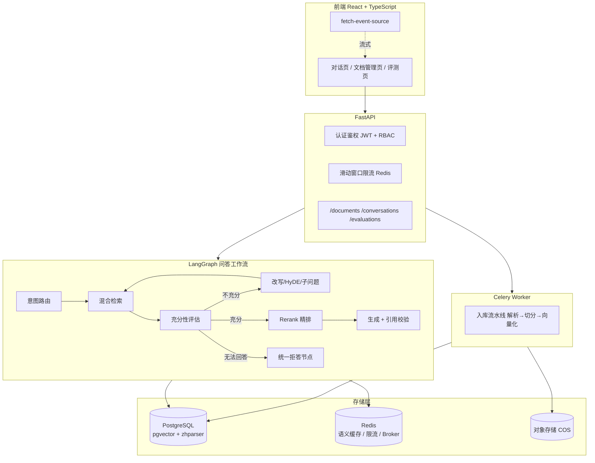
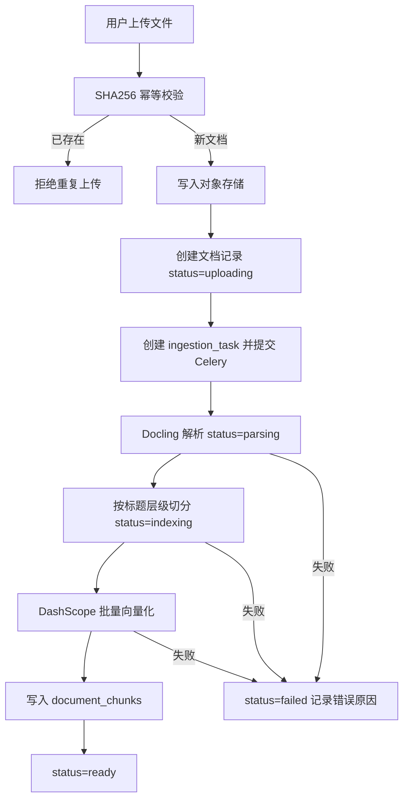
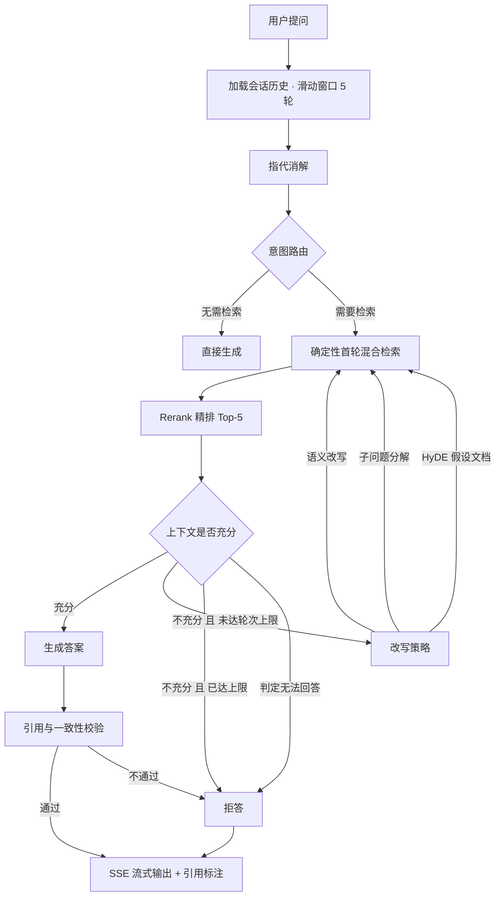

# RAG 知识库问答系统

一套可私有化部署的企业级 RAG 知识库问答系统：上传文档后自动完成解析、切分、向量化，问答时由 LangGraph 编排的 Agentic RAG 工作流自主决定"直接答、换个方式再检索一次、还是明确拒答"，每条答案附带可回溯的引用来源。

后端 Python + FastAPI + LangChain / LangGraph，前端 React + TypeScript，检索层基于 PostgreSQL（pgvector + zhparser）自建混合检索，不依赖任何托管向量数据库。

---

## 核心特性

**文档入库**

- 支持 PDF / DOCX / Markdown / HTML，Docling 统一解析为结构化文本
- 按标题层级切分，保留章节上下文，chunk 带层级路径元信息
- SHA256 幂等校验，重复上传直接拒绝
- Celery 异步处理，`ingestion_tasks` 表逐步记录解析 / 切分 / 向量化进度与失败原因，支持断点重跑
- 文档状态流转：`uploading → parsing → indexing → ready / failed`

**检索**

- 双路召回：pgvector 余弦相似度检索 + PostgreSQL zhparser 中文全文检索
- 向量路以 0.6 相似度阈值预过滤，砍掉明显不相关的候选，降低精排成本
- RRF（k=60）倒数排名融合，两路等权，无需手工调权重
- qwen3-rerank 交叉编码精排，Top-15 裁剪至 Top-5
- 单路异常自动降级为另一路，主链路不中断

**问答**

- LangGraph StateGraph 编排：意图路由 → 确定性首轮检索 → 充分性评估 → 查询改写 / 子问题分解 / HyDE → 生成或拒答
- 首轮召回不充分时自动改写补充检索，最多两轮，超过则走拒答
- 进图前加载会话历史并做指代消解，滑动窗口保留最近 5 轮
- SSE 逐 token 流式输出
- 五层拒答拦截，答案强制编号标注引用来源，`answer_citations` 表落库可回溯

**工程能力**

- JWT 认证 + RBAC 角色权限，检索层做文档级权限过滤
- Redis 语义缓存（RedisVL，阈值 0.92）+ 滑动窗口限流
- LangSmith 全链路追踪，节点级输入输出与耗时可追溯
- 自构造评测集 + RAGAS 自动化评测，Bad Case 归因
- Docker Compose 编排基础设施，systemd 管理服务，Nginx 反向代理

## 

---

## 快速开始

### 环境要求

- Python 3.12+
- Node.js 20+
- Docker + Docker Compose
- [uv](https://docs.astral.sh/uv/)（Python 包管理）

### 1. 启动基础设施

```bash
cp .env.example .env        # 按下面的说明填好模型 API Key
docker compose up -d        # PostgreSQL(pgvector + zhparser) + Redis Stack
```

PostgreSQL 镜像在 `pgvector/pgvector:pg16` 之上叠加了 zhparser，一次构建同时支持向量检索与中文全文检索。

### 2. 初始化数据库

```bash
cd backend
uv sync
uv run alembic upgrade head
uv run python -m app.db.seed    # 创建默认管理员
```

### 3. 启动后端

```bash
uv run uvicorn app.main:app --reload --port 8000
uv run celery -A app.celery_app worker --loglevel=info
```

### 4. 启动前端

```bash
cd frontend
npm install
npm run gen:api  
npm run dev
```

打开 <http://localhost:5173> ，接口文档 <http://localhost:8000/docs> 。

### 必要的环境变量

| 变量                                              | 说明                                                         |
| ----------------------------------------------- | ---------------------------------------------------------- |
| `EMBEDDING_API_KEY`                             | DashScope API Key，用于 text-embedding-v3                     |
| `CHAT_API_KEY` / `CHAT_BASE_URL` / `CHAT_MODEL` | 对话模型。默认走 DashScope 通义千问；OpenAI 兼容协议，换成 DeepSeek-V3 只需替换这三项 |
| `RERANK_API_KEY` / `RERANK_MODEL`               | Reranker，默认 qwen3-rerank                                   |
| `DATABASE_URL`                                  | 需用 `asyncpg` 驱动                                            |
| `COS_SECRET_ID` 等                               | 腾讯云 COS 对象存储，留空则走本地文件系统                                    |
| `LANGSMITH_API_KEY`                             | 可选，开启全链路追踪                                                 |

其余参数（切分大小、检索阈值、缓存阈值、限流）在 `.env.example` 里都有默认值和注释。

---

## 系统架构



### 目录结构

```
.
├── backend/
│   └── app/
│       ├── api/            # FastAPI 路由、依赖注入、Pydantic Schema
│       ├── core/           # 配置、日志、安全、Redis、限流、可观测性
│       ├── db/             # SQLAlchemy 模型、Repository 层、Alembic 迁移
│       ├── ingestion/      # 文档解析、切分、向量化、Celery 任务
│       ├── retrieval/      # 向量检索 / 全文检索 / 混合融合
│       ├── llm/            # Planner、Query 改写、Rerank、答案校验、Prompt
│       ├── services/       # 业务编排层
│       ├── evaluation/     # 评测集管理、RAGAS 运行、打分
│       ├── mcp_server/     # MCP 协议暴露知识库能力
│       └── celery_app.py
├── frontend/               # React 19 + TypeScript + Ant Design
├── deploy/                 # Nginx 配置、systemd 服务单元
├── postgres.Dockerfile     # pgvector + zhparser 自定义镜像
└── docker-compose.yml
```

---

## 文档入库流程



每个阶段的状态与错误信息都落在 `ingestion_tasks` 表里，前端可看到"这一步卡在哪"，失败后支持从失败步骤重跑，不用整个文档重来。

---

## 问答链路



**五层拒答拦截**：Planner 判定无法回答 / 向量最高分低于阈值 / 检索空结果 / Rerank Top-1 低于阈值 / 答案与上下文一致性校验失败。所有拒答收敛到同一个节点，输出统一的拒答话术与原因，便于统计和归因。

---

## 关键设计与取舍

这部分是做这个项目时真正花时间的地方，也是我最想讲清楚的部分。

**1. 切分为什么按标题层级，而不是递归字符切分**

技术文档、规范、手册这类材料，一句话脱离了章节标题就失去了约束条件（适用范围、前提条件、例外情况）。递归字符切分按长度硬切，很容易把条文编号和正文切成两个 chunk，召回时拿到正文但拿不到它属于哪一条。所以改成按标题层级切分，chunk 上带层级路径元信息，召回后能还原"这条出自哪一章哪一节"。

**2. 为什么必须上全文检索**

纯向量检索对术语、编号、型号、里程这类**强精确匹配**的需求表现很差——语义相近但编号错了，答案就是错的。所以加了 zhparser 中文全文检索作为第二路。两路各有各的强项：向量路管语义泛化，全文路管精确命中。

**3. RRF 融合的代价**

用 RRF（k=60，两路等权）是因为它免量纲——向量相似度是 0~1 的余弦，全文检索是 ts_rank 分值，两者根本不在一个尺度上，加权求和还得手工调权重，换批文档就得重调。RRF 只看排名不看分数，规避了这个问题。

代价是**分数信息被丢掉了**：融合后你只知道候选的相对次序，不知道"有多相关"。所以后面必须补一层 Rerank——它不只是提精度，更是把被 RRF 丢掉的置信度重新找回来，后续的拒答阈值才有依据。

**4. 0.6 向量阈值不是拍脑袋定的**

它的作用是**预过滤**：先砍掉明显不相关的候选，把进 Rerank 的候选数压下来，直接省掉一部分精排调用成本。定太高会误杀，定太低省不了钱，是看着召回率曲线和精排开销一起定的。

**5. Rerank 阈值从 0.5 降到 0.3，是被一个真实 bad case 逼的**

最初 Rerank Top-1 阈值定在 0.5，上线后发现现场人员的**口语化提问**大量被误杀——比如"打锚杆间距多少"这种问法，和文档里"锚杆布置间距应符合下列规定"的书面表述差异很大，精排分数被压到 0.5 以下，直接走了拒答。这类问题明明有答案，却答不出来，是最伤体验的。把阈值降到 0.3 之后召回正常。

这个 case 的结论是：**拒答阈值不能只看指标调，必须拿真实用户的问法去回归**。

**6. 一致性校验拦不住"看起来完整"的错误答案**

反过来的 bad case 更隐蔽：知识库里只入库了一部分报告，用户问的内容恰好和某个 chunk 话题高度吻合，五层校验全过，模型基于**残缺的数据**答出了一个看起来非常完整、每条都带引用的答案。一致性校验在这里是失效的——答案确实忠实于上下文，只是上下文本身不完整。

处理办法是在生成 Prompt 里明确要求：如果上下文不足以覆盖问题的全部方面，**必须说明缺哪部分**，而不是自行补全。这类问题的一致性校验拦不住，只能靠覆盖度约束和资料范围元信息。

**7. 降级要能被观测到，否则等于静默失败**

双路检索任意一路异常会自动降级为另一路，Rerank 超时也会降级为不重排。但"能降级"只是第一步——如果降级悄悄发生没人知道，链路看着正常、效果一直在掉，这是最危险的状态。所以降级按**5 分钟窗口统计降级率**，超过阈值推送到群机器人告警，并且**分路统计**，一眼能看出是向量路坏了还是全文路坏了。

**8. 会话历史为什么是滑动窗口 + 指代消解**

全量历史塞进 Prompt 会迅速吃掉上下文预算，而且早期内容与当前问题无关时还会干扰检索。所以只保留最近 5 轮，并在**进图之前**做指代消解——否则"它的间距是多少"这种问法，进检索时拿到的 query 是残缺的，第一步就召不回东西。

**9. 入库任务为什么要单独建表追踪**

文档解析是分钟级的耗时操作，放在请求里同步做必然超时。交给 Celery 之后，如果只有一个"成功/失败"，用户看到的就是转圈然后失败，不知道卡在哪、能不能重试。所以每一步都写 `ingestion_tasks` 表，失败记录到具体步骤，支持从失败步骤重跑而不是整个文档重来。任务本身做了幂等设计，重复提交不会产生重复 chunk。

**10. 语义缓存的阈值为什么定得这么高（0.92）**

问答场景下缓存命中错误的代价比缓存未命中高得多——缓存未命中只是慢一点，命中错误的语义相近问题就是**答错**。所以宁可命中率低一些，也要保证命中的确实是同一个问题。另外缓存命中必须叠加**权限范围校验**：同样一句话，不同权限的用户可见的文档集不同，答案也不同。

---

## 数据模型

| 表                                      | 用途                  |
| -------------------------------------- | ------------------- |
| `documents`                            | 文档元数据、状态、权限标签       |
| `document_chunks`                      | 切分后的文本块、层级路径、向量     |
| `ingestion_tasks`                      | 入库任务每一步的状态与错误信息     |
| `conversations` / `messages`           | 会话与消息               |
| `answer_citations`                     | 答案引用来源，可回溯到具体 chunk |
| `evaluation_runs` / `evaluation_items` | 评测运行与逐条结果           |
| `users` / `roles`                      | 用户与角色权限             |

---

## 部署

```bash
docker compose up -d                      # PostgreSQL + Redis
sudo cp deploy/rag-kb-api.service /etc/systemd/system/
sudo cp deploy/rag-kb-celery.service /etc/systemd/system/
sudo systemctl enable --now rag-kb-api rag-kb-celery
sudo cp deploy/nginx.conf /etc/nginx/conf.d/rag-kb.conf   # 反向代理 + 前端静态托管
```

前端 `npm run build` 后由 Nginx 托管静态资源，`/api` 反代到后端 8000 端口。

---

## 后续计划

- [ ] 结构化数据的问答（当前只处理非结构化文档）
- [ ] 增量索引：文档更新时只重建受影响的 chunk，并失效相关语义缓存
- [ ] 多模态：图片与表格的解析与检索
- [ ] 检索链路的 A/B 实验框架，让策略调整有数据支撑

---

## 说明

本项目为个人独立开发的学习与工程实践项目，代码与文档均为原创实现，不含任何公司项目代码或业务数据。
